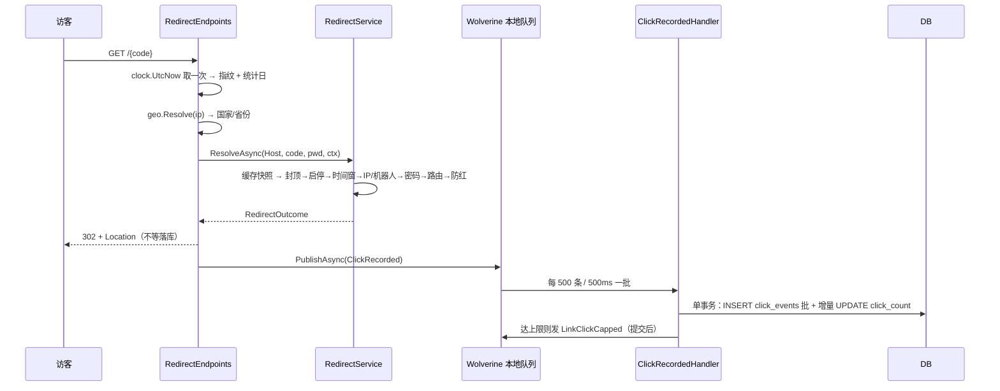
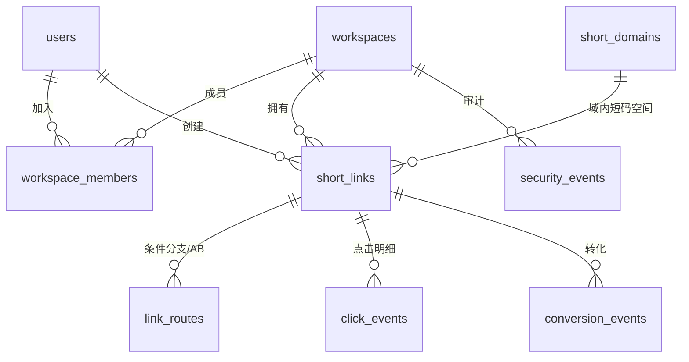

# ShortLink · 技术架构与概要设计说明书

| 项 | 内容 |
| --- | --- |
| 系统名称 | ShortLink（自建短链接平台） |
| 技术栈 | .NET 10 · ASP.NET Core Minimal API · EF Core 10 · Blazor WebAssembly(MudBlazor 9) |
| 版本 | 1.0（P0 + P1 + P2 + P3 全部落地） |
| 文档日期 | 2026-11-12（初版 2026-11-11） |
| 相关文档 | `README.md`（使用与部署）、`AGENTS.md`（工程约定）、`docs/roadmap.md`（能力矩阵与技术债）、`docs/api/biz-codes.md`（码表）、`docs/adr/0004~0012`（关键决策） |

---

## 1. 系统定位

一套可自托管的短链平台，覆盖「建链 → 跳转 → 统计 → 归因」主链路，并补齐运营（多用户/批量/导出）、实验（条件路由/A-B）、安全（黑白名单/风控/审计）与工程化（限流/探针/保留策略/消息总线）能力。

**三个硬性约束**（贯穿全部设计）：

1. **前后端完全分离**。后端只暴露统一信封的 HTTP API，前端是纯 WASM SPA，通过 Bearer Token 调用，不使用 Cookie，不共享服务端会话。
2. **数据库可切换**。默认 SQLite 可零依赖启动，生产用 MySQL 8（`Microting.EntityFrameworkCore.MySql`），同时支持 PostgreSQL。
3. **跳转路径不碰数据库**。一次跳转 = 一次缓存读取 + 一次消息发布，这是整套架构的性能基线。

### 1.1 质量目标

| 维度 | 目标 | 落地手段 |
| --- | --- | --- |
| 跳转延迟 | P99 < 20ms（缓存命中） | 三级缓存 + 规则随缓存快照下发，纯内存选择 |
| 写入吞吐 | 单实例 ≥ 2000 次跳转/秒 | 点击走消息总线批处理（500 条 / 500ms），增量 UPDATE |
| 统计一致性 | 最终一致，延迟 ≤ 2s | 批处理落库；计数器与明细同一事务 |
| 可用性 | 无状态水平扩展 | JWT 无会话、缓存与限流可外置 Redis |
| 契约稳定 | 业务码只增不改 | 码段分层 + `BizCodes` 单一来源 |

---

## 2. 总体架构

### 2.1 分层结构

依赖方向严格单向，由 ArchUnitNET 在测试阶段守护（`ShortLink.ArchitectureTests`）：

```
                 ┌──────────────────────────────────────────┐
                 │  ShortLink.Web (Blazor WASM + MudBlazor) │  独立站点，仅依赖 Contracts
                 └───────────────────┬──────────────────────┘
                                     │ HTTP + Bearer JWT
     ┌───────────────────────────────┴────────────────────────────────┐
     │  ShortLink.Api（宿主：端点 / 认证 / 限流 / 异常收口）            │
     │  ShortLink.Mcp（入口适配层：MCP 工具，与 HTTP 端点平级）         │
     └───────────────────────────────┬────────────────────────────────┘
                                     │
                 ┌───────────────────┴───────────────────┐
                 │  ShortLink.Infrastructure            │
                 │  EF Core / 仓储 / JWT / 缓存 / 消息    │
                 └───────────────────┬───────────────────┘
                                     │ 只依赖端口接口
                 ┌───────────────────┴───────────────────┐
                 │  ShortLink.Application               │
                 │  用例编排 / 端口抽象 / 校验            │
                 └───────────────────┬───────────────────┘
                                     │
                 ┌───────────────────┴───────────────────┐
                 │  ShortLink.Domain                    │
                 │  实体 / 聚合 / 领域规则（零框架依赖）  │
                 └───────────────────────────────────────┘

     ShortLink.Contracts ←──── 被 Api / Mcp / Web 共同引用（信封、业务码、DTO）
```

**约束细节**：

- `Domain` 禁止引用 EF Core 与 ASP.NET Core；领域层不知道时区、不知道 HTTP，`ClickEvent.Create` 的 `clickDate` 由调用方算好传入。
- `Application` 禁止引用 `Microsoft.AspNetCore.Http`；HTTP 相关能力（当前用户、请求上下文）通过 `ICurrentUser` 等端口注入。
- `Api` 禁止使用 `ProblemDetails`：默认契约是统一信封，混入第二套错误模型会让前端要写两条分支。
- `Mcp` 禁止引用 `DbContext`、仓储与 `Infrastructure`：它是入口适配器，不是第二套业务实现。

### 2.2 程序集划分

| 程序集 | 职责 | 关键内容 |
| --- | --- | --- |
| `ShortLink.Contracts` | 前后端共享契约 | `ApiResponse`（信封）、`BizCodes`、分页 DTO、各领域请求/响应模型 |
| `ShortLink.Domain` | 实体与业务规则 | `Link`/`LinkRoute`/`RouteSelector`/`ShortCode`/`ClickEvent`/`ConversionEvent`/`User`/`Workspace`/`SecurityEvent` |
| `ShortLink.Application` | 用例编排与端口 | `LinkService`、`RouteService`、`AnalyticsService`、`ExportService`、`RedirectService`、`AccessPolicy`、`LinkPolicy`、8 个仓储接口 |
| `ShortLink.Infrastructure` | 技术实现 | `ShortLinkDbContext`、8 个仓储实现、`FusionLinkCache`、`WolverineClickRecorder`、JWT、限流、GeoIP、保留策略服务 |
| `ShortLink.Infrastructure.Migrations.*` | 三套独立迁移 | Sqlite / MySql / PostgreSql，各自 `DbContext` 设计时工厂 |
| `ShortLink.Api` | HTTP 宿主 | 9 个端点类 + 落地页渲染器、`GlobalExceptionHandler`、`ResponseNormalizationMiddleware`、`AuthenticationSetup` |
| `ShortLink.Mcp` | MCP 服务端 | 9 个工具、`McpToolRunner`（异常→工具错误映射）、工具级鉴权、独立指标 |
| `ShortLink.Web` | 管理后台 | 7 个页面 + 12 个组件，MudBlazor 9，`ApiClient` 统一按 `code` 判定 |
| `tests/*` | 三层测试 | 单测（领域/解析/时区/地理）、集成（WebApplicationFactory + 真实迁移）、架构（ArchUnitNET） |

### 2.3 部署视图

```
              ┌──────────┐
   用户 ─────▶ │ CDN / 反代│ ──▶ Host 透传、剥离伪造头、注入 X-Country
              └────┬─────┘
        ┌──────────┴───────────┐
        ▼                      ▼
  ┌───────────┐          ┌───────────┐        ┌──────────┐
  │ Api 实例 1│          │ Api 实例 N│◀──────▶│  Redis   │  缓存背板 + 分布式限流
  └─────┬─────┘          └─────┬─────┘        └──────────┘
        │                      │
        └──────────┬───────────┘
                   ▼
          ┌─────────────────┐        ┌──────────────┐
          │ MySQL / PgSQL   │        │ Kafka（可选）│  仅 Messaging:Transport=kafka
          └─────────────────┘        └──────────────┘

  ShortLink.Web 为纯静态站点（nginx / OSS / 任意静态托管），与 Api 无耦合部署。
```

**关键点**：Api 与 Web 可分别扩缩容；Api 无状态，唯一共享状态是数据库与（可选）Redis。

---

## 3. 关键设计决策

### 3.1 统一信封（全 200）

所有业务接口返回 `HTTP 200` + `{code, msg, data, errors?}`，业务失败 `data = null`。**唯一的例外是跳转与探针**（保留真实 301/302/403/404/410），它们已在归一化白名单中排除。

| 失效的机制 | 补偿手段 |
| --- | --- |
| 前端 `response.ok` / axios 拦截器 | `ApiClient` 统一按 `code` 判定，40101 自动跳登录 |
| APM 错误率/成功率统计 | span 打 `business.code` 标签 + `shortlink.business.failures{code}` 指标 |
| 网关按状态码重试/熔断 | 响应头 `X-Biz-Code`（CORS 已暴露），网关可按 body `code` 判定 |
| 浏览器读取下载文件名 | `WithExposedHeaders("Content-Disposition")` |

业务码分段（只增不改，详见 `docs/api/biz-codes.md`）：

| 段 | 含义 | 段 | 含义 |
| --- | --- | --- | --- |
| 2xxxx | 成功（200/20201） | 13xxx | 短链（含跳转失败态） |
| 4xxxx | 参数/认证/限流等协议层 | 14xxx | 条件路由 |
| 11xxx | 用户与认证 | 15xxx | 转化归因 |
| 12xxx | 域名 | 16xxx | 安全事件 |
| 50001 | 未预期异常 | 17xxx | 导出 |

### 3.2 多数据库切换（ADR 0004）

EF Core 10 + 三个迁移程序集。切换只改配置不改代码：

```jsonc
"Database": { "Provider": "Sqlite|MySql|PostgreSql", "ConnectionString": "…", "MySqlVersion": "8.0.36" }
```

MySQL 驱动选 `Microting.EntityFrameworkCore.MySql`（MIT，Pomelo 分支）——官方与 Pomelo 9.x 均不支持 EF 10。代价是 **schema 变更要生成三次迁移**（已列入技术债 4）。

### 3.3 三级缓存与防穿透

```
请求 → 域名缓存(Host→domainId) → 短链缓存(domainId+code → LinkSnapshot) → 未命中回源 DB → 写回
                                  ↑ 规则/密码/时间窗全部在快照里，跳转不再查库
```

- FusionCache 2.9：`GetOrSet` + **负缓存**（不存在的短码缓存空值，防止随机码打穿 DB）+ fail-safe（回源失败时用过期快照顶着）。
- 更新/停用/删除后主动失效；配置 Redis 后失效通过背板传播到其他实例，未配置时靠 TTL（60s）收敛——这一降级在启动日志与 `/health/info` 中显式声明（ADR 0009）。

### 3.4 点击采集走消息总线（ADR 0008）



三个配置维度**互相独立**（这是最容易混淆的地方）：

| 维度 | 配置 | 决定什么 | 默认 |
| --- | --- | --- | --- |
| 传输 | `Messaging:Transport` | 发去哪：`local` 进程内 / `rabbitmq` / `kafka` | `local` |
| 持久化 | `Messaging:Durable` | 是否先落本地消息表 | `false` |
| 聚合 | `ClickBatchSize` / `ClickBatchTimeoutMilliseconds` | 攒批策略 | 500 条 / 500ms |

**核心取舍：点击永远不进消息表。** 给点击开持久化等于每次跳转多一次 `INSERT` + `DELETE`，换来的只是「崩溃不丢一条点击」——而点击本来就是允许丢的数据。持久化范围逐个队列 opt-in（`LinkClickCapped` / `LinkDisabled` 在 `Durable=true` 时进表），**不能用 `Policies.UseDurableLocalQueues()`**：它是启动期端点策略，会把点击队列一起 enrol 进去且后写覆盖不回来。

### 3.5 跳转判定顺序（固定）

```
点击封顶 → 启停状态 → 生效时间 → 过期时间 → IP/机器人策略 → 访问密码 → 条件路由 → 防红中间页
```

两处顺序不可调整，理由是业务语义而非实现便利：

- **封顶在启停之前**：达阈值会自动停用，若先判状态，访客只看到「链接已停用」，不知道是达到上限。
- **密码在路由之前**：否则未通过密码验证的人可以通过命中分支的名称/目标探知真实落地页。

详见 ADR 0005。

### 3.6 条件路由与 A/B

- 8 个匹配字段：`country`/`province`/`device`/`browser`/`os`/`language`/`referer`/`query`。
- 9 个运算符：`eq`/`neq`/`contains`/`not_contains`/`prefix`/`in`/`not_in`/`exists`/`not_exists`。
- 条件组 `Match = All | Any`（AND / OR），JSON 存 `conditions_json`，**解析失败按「该分支不命中」处理**——坏数据不能把整条短链打成 404。
- 优先级 `-100..100`，同优先级内按权重分流；种子 `SHA256(visitorKey|linkId|priority)`，**无服务端会话**也能保证同一访客稳定命中同一分支。
- 选择逻辑是纯函数（`RouteSelector.Select`），不碰数据库、不持状态，可单测、可随缓存快照复用。

### 3.7 权限模型

四角色：`viewer` < `member` < `admin` < `owner`。工作区 ID 进 JWT 的 `ws` 声明。

- 端点用命名策略：`viewer` / `writer` / `manager` / `owner-only`，禁止裸 `RequireAuthorization()`。
- 对象级权限统一走 `LinkPolicy.CanModify`（Domain 规则 + `ICurrentUser`），不在端点或服务里各判一遍。
- **任何按 ID 直查的用例都必须再校验工作区**，否则换个 ID 就能读到别人的数据（`AnalyticsService.LoadVisibleAsync` 是范例）。
- 角色排序口径只有两处且必须一致：后端 `UserRoles.Rank`、前端 `Permissions.Rank`。

### 3.8 时间、时区与来源地（ADR 0009）

| 关注点 | 设计 | 为什么不能偷懒 |
| --- | --- | --- |
| 存储 | 全部 UTC，列名后缀 `_utc` | 多实例/多区域一致 |
| 统计日界 | `IStatisticsCalendar`：`click_date` 写入、趋势区间、「今日」共用同一日历；`Analytics:TimeZone` 默认 `UTC` | 硬编码 UTC 会让东八区运营者看到「早八点前算昨天」 |
| 访客去重 | 指纹日期同样取 `IStatisticsCalendar`，**不是** UTC 日期 | 否则非 UTC 部署下自然日被 UTC 零点劈成两段，同一人算两次 |
| 来源地 | `IGeoLocationResolver` 两实现：CDN 头（头名可配）/ MaxMind GeoLite2 | 头可被伪造，库是兜底；采集处**不做 HtmlEncode**，否则条件路由永不命中 |

### 3.9 MCP 接入（ADR 0007）

MCP 是**入口适配层**，与 HTTP 端点平级，共享 Application 用例。三条与 HTTP 契约刻意不同的约定：

1. 失败返回 `IsError = true`，**不套信封**——模型会把 `{code:13001}` 当成功结果继续推理。
2. 端点保留真实 401，不参与归一化——MCP 客户端靠 401 触发重新认证。
3. 限流按调用者 `sub` 分区，不是按 IP——AI 客户端常从同一出口 IP 批量调用。

---

## 4. 模块与功能概要

完整清单见 `docs/feature-list.md`，可视化见 `docs/features-mindmap.md`。此处只给模块级职责。

| 模块 | 核心能力 | 归属层 |
| --- | --- | --- |
| 短链管理 | CRUD、自定义短码、启停、时间窗、点击封顶、批量操作、CSV 导出 | Api + Application + Domain |
| 跳转引擎 | 三级缓存、8 步判定、HTML 落地页、防红中间页、307/308 保方法 | Api + Application |
| 域名管理 | 多域名、域内独立短码空间、默认域名兜底 | Domain + Application |
| 统计分析 | 今日/累计、UV、按天趋势、6 个维度 TopN、明细、分支效果 | Application + Infrastructure |
| 条件路由 | 条件组、优先级、权重分流、试算 | Domain（纯函数） |
| 转化归因 | HMAC 回调、幂等、分支级转化率与价值 | Domain + Application |
| 安全 | IP 黑白名单（CIDR）、机器人策略、目标扫描、事件台账、滥用举报 | Domain + Application |
| 账号与工作区 | 登录、改密、角色、工作区隔离 | Application |
| 消息总线 | 点击批处理、封顶审计、transport 可切换 | Infrastructure |
| MCP | 9 个工具、工具级鉴权、独立限流与指标 | Mcp |

---

## 5. 数据模型概要

字段级说明、索引设计与多库类型差异见 `docs/database-design.md`；本节只给结构与容量视角。

### 5.1 实体关系



### 5.2 表清单

| 表 | 说明 | 关键索引 |
| --- | --- | --- |
| `short_links` | 短链聚合根：短码、目标、跳转类型、时间窗、密码哈希、`max_clicks`、`click_count`、乐观并发令牌 | `ux(domain_id, code)` 唯一；`code`；`expires_at_utc`；`click_count`；`(workspace_id, created_at_utc)` |
| `short_domains` | 域名：Host、协议、是否默认 | `ux(host)` 唯一；`ux(default_slot)` 唯一（保证至多一个默认域名） |
| `link_routes` | 条件分支：`name`/`priority`/`weight`/`target_url`/`conditions_json`/`click_count` | `(link_id, priority)`；`ux(link_id, name)` |
| `click_events` | 点击明细，唯一线性增长表；`event_id` 支撑重复投递幂等 | `ux(event_id)`；`(clicked_at_utc, id)`；`(link_id, id)`；`(link_id, click_date)`；`(click_date)`；`(click_date, visitor_hash)`；`(link_id, route_id)`；`(workspace_id, click_date)` |
| `conversion_events` | 转化回调，幂等 | `ux(link_id, event_id)`、`(workspace_id, created_at_utc)` |
| `security_events` | 安全审计（封顶、拦截、举报等） | `(workspace_id, created_at_utc)`、`(link_id, created_at_utc)` |
| `users` | 账号、密码哈希、角色、启用状态、令牌版本 | `ux(user_name)` 唯一 |
| `workspaces` / `workspace_members` | 工作区与成员关系 | `ux(slug)`、`ux(workspace_id, user_id)` |
| `click_retention_leases` | 点击明细清理的跨实例租约 | 主键 `name` |

### 5.3 容量设计

- **计数器与明细分离**：`short_links.click_count` 与 `link_routes.click_count` 用 `ExecuteUpdate` 增量更新（并发安全），列表页与总览不扫明细表。
- **点击幂等**：每次跳转生成 `event_id`，批落库前先查已存在的 ID 并跳过；`ux(event_id)` 兜底重复投递。
- **清理互斥**：`click_retention_leases` 单行租约，多副本同时开启保留策略时只有一个实例执行删除。
- **明细按 `click_date` 聚簇**：趋势与维度统计全部走 `click_date`，因此日界口径必须先定死（见 3.8），否则索引白建。
- **唯一线性增长点**：`click_events`。`Analytics:Retention` 默认关闭，开启后按 `clicked_at_utc` 时间水位分批 `DELETE`（单批上限 / 单次总量上限 / 批间停顿全部显式配置），删除不可逆。清理是精确时间语义，与 `click_date` 的统计日界无关。

---

## 6. 接口设计

### 6.1 版本与文档

- 路径版本：`/api/v{version}`，`UrlSegmentApiVersionReader`，默认 `1.0`，`ReportApiVersions` 输出可用版本。
- OpenAPI：`/openapi/v1.json`；交互文档：Scalar `/scalar/v1`。

### 6.2 端点分组

| 分组 | 前缀 | 鉴权 |
| --- | --- | --- |
| 认证 | `/api/v1/auth` | 登录匿名（限流 10/min/IP），其余需登录 |
| 域名 | `/api/v1/domains` | `viewer` 读 / `manager` 写 |
| 短链 | `/api/v1/links` | `viewer` 读 / `writer` 写（对象级再校验） |
| 统计 | `/api/v1/dashboard`、`/links/{id}/stats` | `viewer` |
| 用户 | `/api/v1/users` | `admin` 及以上 |
| 安全 | `/api/v1/security` | `manager` 及以上 |
| 转化 | `/api/v1/conversions` | 匿名 + HMAC 签名（限流 600/min/IP） |
| 举报 | `/api/v1/abuse/reports` | 匿名（限流 20/min/IP） |
| 跳转 | `/{code}` | 匿名，真实状态码 |
| 探针 | `/health`、`/health/ready`、`/health/info` | 匿名 |
| MCP | `/mcp` | 登录 + `sub` 维度限流 |

### 6.3 中间件管线（顺序有语义）

```
ForwardedHeaders（仅信任代理时）→ ExceptionHandler → ResponseNormalization
→ SerilogRequestLogging → Cors → Authentication → Authorization → RateLimiter → Endpoints
```

- **异常收口在最外层**：任何下游异常都归一化成信封。
- **归一化在认证之前**：401/403 由 `JwtBearerEvents` 直接写信封（绕过中间件），因此 `/mcp` 与跳转路径需要在**两处**同时排除（白名单 + challenge 事件判路径），只改一处会漏。
- **短码路由最后注册**：`/{code}` 是单段通配，必须排在所有前缀路由之后。

---

## 7. 横切设计

### 7.1 限流

| 策略 | 阈值 | 分区键 | 说明 |
| --- | --- | --- | --- |
| `auth` | 10/min | 来源 IP | 登录/改密 |
| `conversion` | 600/min | 来源 IP | 转化回调 |
| `abuse` | 20/min | 来源 IP | 匿名举报 |
| `link-password` | 10/min | 来源 IP + 短码 | 访问密码尝试，避免对单条短链爆破 |
| `mcp` | 120/min | JWT `sub` | AI 客户端，按人而非按出口 IP |

- 必须**按分区键限流**，禁止 `AddFixedWindowLimiter("name")`——那是全进程共享窗口，一人刷满全站被堵。
- 配 Redis 后切 Lua 原子计数（`INCRBY` + `PEXPIRE` 同一脚本）；Redis 故障时回落本地窗口并累加 `shortlink.ratelimit.fallbacks`。
- 未开 `ReverseProxy:TrustForwardedHeaders` 时分区键是代理 IP，全站共享一个桶——反代部署下这一项是强制的。

### 7.2 可观测性

| 信号 | 内容 |
| --- | --- |
| Traces | ASP.NET Core + HttpClient + 自定义 `ShortLinkDiagnostics` / `McpDiagnostics` 源；`/health` 请求被过滤 |
| Metrics | `shortlink.redirects{result}`、`shortlink.business.failures{code}`、`shortlink.clicks.dropped`、`shortlink.ratelimit.fallbacks`、MCP 调用计数 |
| Logs | Serilog 控制台 +（配 OTLP 时）日志导出；`service.name`、`deployment.environment` 统一标签 |

OTLP 端点为空时只打控制台，不外发——单机开发不需要 collector。

### 7.3 探针分层

| 端点 | 语义 | 内容 |
| --- | --- | --- |
| `/health` | 存活 | 只证明进程能响应，**不查外部依赖**（否则数据库抖动会升级为全体重启） |
| `/health/ready` | 就绪 | 数据库 `CanConnect` + 缓存可用性，失败返回 503 + `database=ok,cache=fail` |
| `/health/info` | 诊断 | 缓存拓扑（`backplane`/`crossInstanceInvalidation`/`linkTtlSeconds`）+ 统计时区。**不是探针** |

### 7.4 安全基线

- JWT HS256，`SigningKey` < 32 字节直接启动失败；PBKDF2-SHA256 存密码。
- 目标地址扫描：拦截 `javascript:`、内网地址（含 IPv6 与十进制 IP 变体）、自引用，防开放重定向与 SSRF。
- CSV 导出：`= + - @` 前缀阻断 + UTF-8 BOM（防公式注入与 Excel 乱码）。
- 转化回调：HMAC-SHA256 over `{timestamp}.{rawBody}`，5 分钟容差，`(link_id, event_id)` 唯一索引幂等。
- `ForwardedHeaders` 仅在显式信任代理时启用：启动时清空框架默认的 `KnownIPNetworks` / `KnownProxies`，只信任 `ReverseProxy:KnownProxies` 列出的地址；配置为空直接启动失败（Development 回落到回环地址）。

---

## 8. 部署与配置

### 8.1 配置矩阵

| 配置节 | 关键项 | 默认 | 变更影响 |
| --- | --- | --- | --- |
| `Database` | `Provider` / `ConnectionString` / `MySqlVersion` | MySql（Development 为 Sqlite） | 切换需对应迁移程序集 |
| `Jwt` | `SigningKey` / `ExpiresMinutes` | 示例值 / 720 | 密钥变更使全部令牌失效 |
| `Cache` | `RedisConnectionString` / `LinkTtlSeconds` / `DomainTtlSeconds` | 空 / 60 / 60 | 空值 = 单实例缓存，**多实例必须配** |
| `Analytics` | `TimeZone` / `Retention.*` | `UTC` / 关闭 | 时区**上线前**定，改后不回溯 |
| `GeoIp` | `DatabasePath` / `CountryHeaders` / `ProvinceHeaders` / `Locales` | 空 / `CF-IPCountry`,`X-Country` / `X-Province` / `zh-CN`,`en` | 配库后按 IP 查，查不到回落请求头 |
| `RateLimit` | `UseDistributed` / 四个 HTTP 阈值 | `null`（随 Redis）/ 10·600·20·10 | 阈值变更即时生效；MCP 配额见 `Mcp` 节 |
| `Messaging` | `Transport` / `Durable` / 批处理 / `RabbitMq.*` / `Kafka.*` | `local` / `false` / 500·500ms | 切 broker 会影响跳转延迟 |
| `Mcp` | `Enabled` / `Path` / `PermitPerMinute` | `false` / `/mcp` / 120 | 等于开一个写入口 |
| `ReverseProxy` | `TrustForwardedHeaders` | `false` | 仅可信代理后开启 |
| `Cors` | `AllowedOrigins` | `localhost:5081` | 前端独立站点，必须白名单 |
| `OpenTelemetry` | `Endpoint` | 空 | 空则只打控制台 |

### 8.2 部署检查清单

1. 短链域名与请求 Host 一致（反代必须 `proxy_set_header Host $host;`）。
2. 多实例 → 配 Redis（缓存失效 + 分布式限流双重理由）。
3. 反代 → 开 `TrustForwardedHeaders`，并在代理层剥离客户端 `CF-IPCountry`/`X-Country`/`X-Province`。
4. 上线前定 `Analytics:TimeZone`，之后不要随意改。
5. 存活探针接 `/health`，就绪探针接 `/health/ready`，不要把依赖塞进存活探针。
6. 保留策略默认关闭；开启即等于放弃保留期外的明细（当前是删除，不是归档）。
7. MCP 默认关闭；开启前确认令牌所属账号角色、限流配额、`AllowedHosts`。

---

## 9. 测试策略

| 层级 | 数量 | 覆盖重点 |
| --- | --- | --- |
| 单测 `ShortLink.UnitTests` | 领域规则、短码生成、UA 解析、路由选择与分流、指纹、时区日历、地理解析、CSV 转义 |
| 集成 `ShortLink.IntegrationTests` | WebApplicationFactory + 真实 SQLite 迁移：登录→建链→跳转→统计→导出→转化→批量→探针，含点击不入消息表的回归断言 |
| 架构 `ShortLink.ArchitectureTests` | ArchUnitNET 分层依赖、Contracts 不引服务端、MCP 不引 Infrastructure、Api 不用 ProblemDetails |

当前默认路径 **212 通过 + 11 跳过**（共 223 个用例，约 8s；跳过的是需要 `SHORTLINK_TEST_CONTAINERS=1` 的容器化用例）。异步副作用校验统一用 `WaitUntilAsync(condition, because)` 轮询，不用固定 `Task.Delay`——固定 sleep 会把启动期故障伪装成业务断言失败。

---

## 10. 演进与已知边界

### 10.1 尚未实现

OIDC 登录与账号绑定、安装向导、点击明细按天归档到冷存储、MCP OAuth 2.1（Protected Resource Metadata + 动态客户端注册）。

### 10.2 主要的已知技术债（完整列表见 `docs/roadmap.md`）

| # | 内容 | 影响面 |
| --- | --- | --- |
| 4 | 迁移三份维护 | schema 变更需生成三次迁移 |
| 13 | 点击队列无容量上限 | 持续过载表现为内存增长而非丢写 |
| 14 | Kafka 路径未跑真实 broker | 上线前必须联调 |
| 16 | 来源地默认依赖可信请求头 | 公网裸暴露时国家/省份可伪造，影响条件路由 |
| 17 | 离线库更新需重启且无过期告警 | 需把 mmdb 替换纳入发布流程 |

### 10.3 扩展点

| 想扩展的方向 | 该动哪里 | 不该动哪里 |
| --- | --- | --- |
| 新增匹配字段/运算符 | `RouteFields` / `RouteOperators` + 前端下拉 | 不要改分流种子公式 |
| 新增数据库 | 新增迁移程序集 + `DatabaseOptions.Provider` 分支 | 不要改仓储接口 |
| 新增消息类型 | `MessagingContracts` + handler + 队列持久化策略 | 不要把点击也塞进消息表 |
| 新增来源地来源 | 实现 `IGeoLocationResolver` 并注册 | 不要在端点里读请求头 |
| 新增 AI 工具 | `ShortLink.Mcp/Tools` + `McpToolRunner` 映射 | 不要注入 `DbContext` |

---

## 11. 术语

| 术语 | 含义 |
| --- | --- |
| 短码 / code | 短链路径段，域内唯一，Base62，去除易混淆字符 |
| 快照 / snapshot | 跳转用的短链只读投影，含规则与密码哈希，随缓存下发 |
| 封顶 / cap | `max_clicks` 达到阈值后自动停用并记安全事件 |
| 分支 / route | 一条短链下的条件目标或多目标 A/B 分支 |
| 指纹 / visitorKey | `SHA256(IP|UA|统计日)` 截断，用于 UV 去重，不可反推 |
| 背板 / backplane | FusionCache 的分布式二级缓存（Redis） |
| 信封 | `{code,msg,data}` 统一响应结构 |
| 归一化 | 把框架层 401/403/429/404 转换成信封的中间件 |
