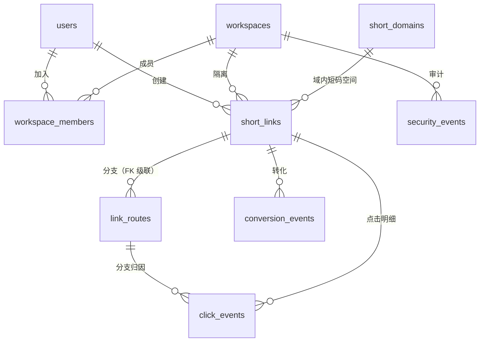

# ShortLink · 数据库设计说明书

| 项 | 内容 |
| --- | --- |
| 数据库 | SQLite（默认，开发与单机）/ MySQL 8（生产推荐）/ PostgreSQL |
| ORM | EF Core 10（`ShortLinkDbContext`） |
| 表数量 | 10 张业务表 + 1 张 EF 迁移历史表 |
| 迁移 | 三套独立迁移程序集，schema 变更需各生成一次（ADR 0004）；Sqlite / PostgreSql 各 3 个，MySQL 4 个（多一个排序规则迁移） |
| 文档日期 | 2026-11-12（初版 2026-11-11） |
| 权威来源 | `src/ShortLink.Infrastructure/Persistence/Configurations/*.cs`——本文档与之一致；不一致时以代码为准并更新本文档 |

DDL 由 EF 生成，可用以下命令复现（本文档的类型标注取自实际产物）：

```bash
dotnet ef migrations script --project src/ShortLink.Infrastructure.Migrations.MySql \
  --startup-project src/ShortLink.Infrastructure.Migrations.MySql --output mysql-ddl.sql
```

---

## 1. 设计原则

| 原则 | 落地方式 | 原因 |
| --- | --- | --- |
| 列名 snake_case | 每个属性在 `Configurations` 中显式 `HasColumnName` | 不依赖 provider 的命名策略，三种库命名完全一致 |
| 时间统一 UTC | 列名后缀 `_utc`，存 `DateTime` | 多实例/多区域一致；本地时间只在展示层出现 |
| 统计日界独立 | 冗余 `click_date`（`date`），由 `IStatisticsCalendar` 算好写入 | 按天聚合可走索引，不必对时间列做函数计算（见 ADR 0009） |
| 枚举存 int | `HasConversion<int>()` | 跨库稳定，可读性由文档与领域枚举承担；**新增值只能追加** |
| 灵活结构存 JSON 文本 | `link_routes.conditions_json varchar(4000)` | 条件结构持续演进，宽表会不断加列且多数行为空 |
| 金额用 decimal | `decimal(18,4)` | 避免浮点累加误差 |
| 主键统一 bigint 自增 | MySQL `AUTO_INCREMENT` / PG `IDENTITY` / SQLite `INTEGER PK AUTOINCREMENT` | 业务键（短码）可变且分域唯一，不适合做主键 |
| 计数器与明细分离 | `short_links.click_count` / `link_routes.click_count` 增量更新 | 列表页与总览不扫 `click_events` |
| 写入幂等与并发控制 | `click_events.event_id` 唯一索引；`short_links.concurrency_token` 乐观并发；默认域名/分支名唯一索引 | 重复投递不重复计数；并发编辑返回 `40901` |

---

## 2. 表清单与关系

| 表 | 角色 | 增长特征 | 清理策略 |
| --- | --- | --- | --- |
| `short_links` | 短链聚合根 | 随建链线性增长，量级小 | 业务删除（级联分支） |
| `short_domains` | 域名字典 | 极少 | 有短链时禁删 |
| `link_routes` | 条件分支 / A/B 目标 | 每条短链 ≤ 20 | 随短链级联删除 |
| `click_events` | 点击明细 | **唯一高频增长表** | 保留策略分批 DELETE（默认关闭） |
| `conversion_events` | 转化回调 | 随转化增长，低于点击 1~2 个数量级 | 暂无（需随明细一起归档） |
| `security_events` | 安全审计 | 低频，异常流量时陡增 | 暂无上限 |
| `users` | 账号 | 极少 | 停用而非删除 |
| `workspaces` | 工作区 | 极少 | 不删 |
| `workspace_members` | 工作区成员关系 | 极少 | 随成员移除 |
| `click_retention_leases` | 点击明细清理租约 | 固定 1 行 | 不清理 |
| `__EFMigrationsHistory` | EF 迁移历史 | 每次迁移 1 行 | 不清理 |



> 图中除 `short_links → link_routes` 外均为**逻辑关联**，库里没有外键约束，理由见 §4。`click_retention_leases` 是独立的单行租约表，不与业务实体关联。

---

## 3. 表结构

类型以 **MySQL** 为准；SQLite / PostgreSQL 的映射差异见 §5。

### 3.1 `short_links` · 短链

写入时机：建链、编辑、启停、点击封顶自动停用、批量操作；`click_count` 由点击批处理增量更新。

| 列 | 类型 | 空 | 默认 | 说明 |
| --- | --- | --- | --- | --- |
| `id` | bigint | N | 自增 | 主键 |
| `workspace_id` | bigint | N | — | 工作区隔离键，所有查询必带 |
| `domain_id` | bigint | N | — | 所属域名 |
| `code` | varchar(32) | N | — | 短码，**域内唯一**（见索引） |
| `target_url` | varchar(2048) | N | — | 目标地址，创建时过安全扫描 |
| `title` | varchar(200) | Y | — | 标题 |
| `status` | int | N | — | `0` 停用 / `1` 启用（`LinkStatus`） |
| `redirect_type` | int | N | — | `301/302/307/308`（值与 HTTP 状态码一致） |
| `expires_at_utc` | datetime(6) | Y | — | 过期时间，空表示永久 |
| `starts_at_utc` | datetime(6) | Y | — | 生效时间，空表示立即 |
| `password_hash` | varchar(256) | Y | — | PBKDF2-SHA256，空表示无密码 |
| `remark` | varchar(500) | Y | — | 备注 |
| `click_count` | bigint | N | 0 | 累计点击计数器，与明细同事务增量更新 |
| `max_clicks` | bigint | Y | — | 封顶阈值，空表示不限；达到后自动停用 |
| `bot_policy` | int | N | `0` | `0` 放行 / `1` 拦截 / `2` 不计数（`LinkBotPolicy`） |
| `ip_allow_list` | varchar(2000) | Y | — | 逗号/换行分隔，含 CIDR |
| `ip_block_list` | varchar(2000) | Y | — | 同上 |
| `fallback_url` | varchar(2048) | Y | — | 路由全部不命中时的兜底地址 |
| `anti_block_enabled` | tinyint(1) | N | 0 | 微信/QQ 内先展示防红中间页 |
| `conversion_secret` | varchar(128) | Y | — | 转化回调 HMAC 密钥，首次取用生成 |
| `created_at_utc` | datetime(6) | N | — | 创建时间 |
| `updated_at_utc` | datetime(6) | N | — | 更新时间 |
| `last_accessed_at_utc` | datetime(6) | Y | — | 最近点击时间（异步回填） |
| `created_by_user_id` | bigint | Y | — | 创建者，`member` 只能改自己创建的 |
| `concurrency_token` | varchar(32) | N | — | 乐观并发令牌，每次写操作重新生成；冲突返回 `40901` |

索引：

| 名称 | 列 | 唯一 | 服务场景 |
| --- | --- | --- | --- |
| `ux_short_links_domain_code` | `(domain_id, code)` | ✅ | 跳转解析与建链冲突检测；**域内唯一**而非全局唯一 |
| `ix_short_links_code` | `(code)` | — | 按短码跨域检索（后台搜索、MCP `shortlink_get`） |
| `ix_short_links_expires_at` | `(expires_at_utc)` | — | 过期清理与「即将过期」筛选 |
| `ix_short_links_click_count` | `(click_count)` | — | 封顶扫描与热门排序 |
| `ix_short_links_workspace_created` | `(workspace_id, created_at_utc)` | — | 列表默认排序（工作区 + 时间倒序） |
| `ix_short_links_workspace_creator` | `(workspace_id, created_by_user_id)` | — | 「只看我创建的」筛选 |

### 3.2 `short_domains` · 域名

| 列 | 类型 | 空 | 说明 |
| --- | --- | --- | --- |
| `id` | bigint | N | 主键 |
| `host` | varchar(128) | N | 形如 `s.example.com` 或 `localhost:5080`，**全局唯一** |
| `scheme` | varchar(8) | N | `http` / `https` |
| `name` | varchar(64) | N | 显示名 |
| `is_default` | tinyint(1) | N | 默认域名，Host 无法匹配时兜底 |
| `default_slot` | int | Y | 默认域名固定为 `1`，其余为 `NULL`；唯一索引保证全库至多一个默认域名 |
| `is_enabled` | tinyint(1) | N | 停用后不参与解析 |
| `created_at_utc` | datetime(6) | N | |

索引：`ux_short_domains_host (host)` 唯一；`ux_short_domains_default_slot (default_slot)` 唯一。删除受应用层 `DomainInUse` 保护（有短链时拒绝），不是外键。

### 3.3 `link_routes` · 条件分支 / A/B

写入时机：`PUT /links/{id}/routes` **全量覆盖**（删旧插新）。

| 列 | 类型 | 空 | 说明 |
| --- | --- | --- | --- |
| `id` | bigint | N | 主键 |
| `link_id` | bigint | N | 所属短链，**唯一的外键**，`ON DELETE CASCADE` |
| `name` | varchar(64) | N | 分支名，全量覆盖时用于归集历史点击 |
| `priority` | int | N | `-100..100`，越大越先命中（`RouteSelector`） |
| `weight` | int | N | `0..1000`，同优先级内按权重分流 |
| `target_url` | varchar(2048) | N | 命中后的跳转目标 |
| `conditions_json` | varchar(4000) | N | 条件组 JSON，空条件表示默认分支 |
| `is_enabled` | tinyint(1) | N | 停用的分支不参与选择 |
| `click_count` | bigint | N | 分支点击计数器 |
| `created_at_utc` / `updated_at_utc` | datetime(6) | N | |

索引：`ix_link_routes_link_priority (link_id, priority)`；`ux_link_routes_link_name (link_id, name)` 唯一——同一短链下分支名不可重复，全量覆盖时靠它阻止同名分支。读取时按短链一次取全部（≤20 条），随短链缓存进快照。

`conditions_json` 结构：

```jsonc
{
  "match": "all",                              // all=AND / any=OR
  "items": [
    { "field": "country", "op": "in", "value": "CN,HK" },
    { "field": "query",   "op": "contains", "value": "utm_source=wechat" }
  ]
}
```

字段取值 `country/province/device/browser/os/language/referer/query`，运算符 `eq/neq/contains/not_contains/prefix/in/not_in/exists/not_exists`。**解析失败按「该分支不命中」处理**，坏 JSON 不会把短链打成 404。

### 3.4 `click_events` · 点击明细

写入时机：消息总线批处理（500 条 / 500ms）单事务批量 INSERT；无 UPDATE、无 DELETE（除保留策略）。

| 列 | 类型 | 空 | 说明 |
| --- | --- | --- | --- |
| `id` | bigint | N | 主键 |
| `workspace_id` | bigint | N | 隔离键 |
| `link_id` | bigint | N | 短链 |
| `domain_id` | bigint | N | 域名（多域名下区分来源） |
| `route_id` | bigint | Y | 命中的分支，空表示兜底地址 |
| `event_id` | char(36) | N | 每次跳转生成的幂等键；批落库前据此跳过重复投递 |
| `code` | varchar(32) | N | 冗余短码，导出与排障免 JOIN |
| `clicked_at_utc` | datetime(6) | N | 精确时间 |
| `click_date` | date | N | **统计日界**，由 `Analytics:TimeZone` 决定，与 `clicked_at_utc` 的 UTC 日期可能不同 |
| `visitor_hash` | varchar(64) | N | `SHA256(IP\|UA\|统计日)` 截断 32 位，用于 UV 去重，不可反推 IP |
| `ip` | varchar(64) | Y | 原始 IP（支持 IPv6） |
| `user_agent` | varchar(512) | Y | 原始 UA |
| `referer` | varchar(1024) | Y | 来源页 |
| `country` | varchar(64) | Y | ISO 码或离线库显示名 |
| `province` | varchar(64) | Y | 离线库才有，请求头方案通常为空 |
| `device` | varchar(32) | Y | desktop/mobile/tablet/bot… |
| `browser` | varchar(64) | Y | |
| `operating_system` | varchar(64) | Y | 列名 `operating_system`，非 `os` |
| `is_bot` | tinyint(1) | N | 机器人标记，计入点击但不计入 UV |

索引（8 条，全部服务于写入幂等、统计查询或清理，没有一条是"顺手加的"）：

| 名称 | 列 | 唯一 | 服务场景 |
| --- | --- | --- | --- |
| `ux_click_events_event_id` | `(event_id)` | ✅ | 重复投递兜底，批处理前先查已存在 ID |
| `ix_click_events_clicked_id` | `(clicked_at_utc, id)` | — | 保留策略按时间水位清理（与 `id` 配合分批） |
| `ix_click_events_link_id` | `(link_id, id)` | — | 最近点击明细的稳定排序与分页 |
| `ix_click_events_link_date` | `(link_id, click_date)` | — | 单链「今日/区间」计数与趋势 |
| `ix_click_events_click_date` | `(click_date)` | — | 全局按天统计、保留策略范围扫描 |
| `ix_click_events_date_visitor` | `(click_date, visitor_hash)` | — | 区间 UV — `DISTINCT visitor_hash` 可走索引 |
| `ix_click_events_link_route` | `(link_id, route_id)` | — | 分支点击聚合 |
| `ix_click_events_workspace_date` | `(workspace_id, click_date)` | — | 工作区总览与隔离校验 |

### 3.5 `conversion_events` · 转化回调

| 列 | 类型 | 空 | 说明 |
| --- | --- | --- | --- |
| `id` | bigint | N | 主键 |
| `workspace_id` | bigint | N | 隔离键 |
| `link_id` | bigint | N | 短链 |
| `route_id` | bigint | Y | 命中的分支，用于分支级转化率 |
| `event_id` | varchar(64) | N | 调用方事件 ID |
| `metric` | varchar(64) | N | 指标名（如 `order_paid`） |
| `value` | decimal(18,4) | N | 转化价值，4 位小数 |
| `ip` | varchar(64) | Y | 回调来源 |
| `created_at_utc` | datetime(6) | N | |

索引：

| 名称 | 列 | 唯一 | 说明 |
| --- | --- | --- | --- |
| `ux_conversion_events_link_event` | `(link_id, event_id)` | ✅ | **幂等键**：同一短链同一事件只入一条，重复回调不重复计数 |
| `ix_conversion_events_workspace_created` | `(workspace_id, created_at_utc)` | — | 工作区转化列表与区间汇总 |

### 3.6 `security_events` · 安全审计

| 列 | 类型 | 空 | 说明 |
| --- | --- | --- | --- |
| `id` | bigint | N | 主键 |
| `workspace_id` | bigint | N | 隔离键 |
| `link_id` | bigint | Y | 相关短链，域名级事件可为空 |
| `code` | varchar(32) | Y | 冗余短码 |
| `type` | int | N | `0` IP 黑名单 / `1` 不在白名单 / `2` 机器人拦截 / `3` 目标被拒 / `4` 滥用举报 / `5` 封顶停用 |
| `message` | varchar(500) | N | 人类可读描述 |
| `ip` | varchar(64) | Y | |
| `user_agent` | varchar(512) | Y | |
| `country` | varchar(64) | Y | |
| `created_at_utc` | datetime(6) | N | |

索引：`(workspace_id, created_at_utc)`、`(link_id, created_at_utc)`。写入必须包 try/catch，审计失败不能把一次正常跳转变成 500。

### 3.7 `users` · 账号

| 列 | 类型 | 空 | 说明 |
| --- | --- | --- | --- |
| `id` | bigint | N | 主键 |
| `user_name` | varchar(64) | N | 登录名，**全局唯一** |
| `display_name` | varchar(64) | N | 显示名 |
| `password_hash` | varchar(256) | N | PBKDF2-SHA256（含盐与迭代次数） |
| `role` | int | N | `0` admin / `1` member / `2` viewer / `3` owner（`UserRole`，**值不是按权限递增的**） |
| `token_version` | int | N | 令牌版本，默认 0；改密、重置、停用、降权时递增，旧 JWT 立即失效 |
| `is_enabled` | tinyint(1) | N | 停用后不能登录 |
| `created_at_utc` | datetime(6) | N | |
| `updated_at_utc` | datetime(6) | Y | |
| `last_login_at_utc` | datetime(6) | Y | |

索引：`ux_users_user_name (user_name)` 唯一。

> 注意 `UserRole` 的整数值顺序（admin=0 … owner=3）与权限强弱无关，**禁止**用 `role > X` 做权限判断，必须走 `UserRoles.Rank` / `UserRoles.AtLeast`。

### 3.8 `workspaces` / `workspace_members`

| `workspaces` 列 | 类型 | 空 | 说明 |
| --- | --- | --- | --- |
| `id` | bigint | N | 主键 |
| `name` | varchar(64) | N | 工作区名 |
| `slug` | varchar(64) | N | 唯一标识，**全局唯一** |
| `is_default` | tinyint(1) | N | 默认工作区（种子创建） |
| `created_at_utc` | datetime(6) | N | |

| `workspace_members` 列 | 类型 | 空 | 说明 |
| --- | --- | --- | --- |
| `id` | bigint | N | 主键 |
| `workspace_id` | bigint | N | 工作区 |
| `user_id` | bigint | N | 用户 |
| `role` | int | N | 该用户在此工作区的角色（同 `UserRole`） |
| `created_at_utc` | datetime(6) | N | |

索引：`ux_workspaces_slug (slug)` 唯一；`ux_workspace_members_workspace_user (workspace_id, user_id)` 唯一——同一人在同一工作区只有一条成员记录。

### 3.9 `click_retention_leases` · 清理租约

多副本同时开启点击明细保留策略时，用单行租约保证只有一个实例执行删除。

| 列 | 类型 | 空 | 说明 |
| --- | --- | --- | --- |
| `name` | varchar(64) | N | 主键，固定为保留策略的租约名 |
| `owner_id` | varchar(32) | Y | 当前持有者；任务结束或释放时置空 |
| `lease_until_utc` | datetime(6) | N | 租约到期时间；每批清理前续约 |
| `last_completed_date` | date | Y | 最近一次成功完成的日期，用于「当天只跑一次」 |

租约使用真实时钟（`IClock.UtcNow`），清理水位仍以传入的 `nowUtc` 计算；每批删除前续约，续约失败立即停止，避免过期持有者继续执行。

---

## 4. 关系与约束策略

**只有一条物理外键**：`link_routes.link_id → short_links.id`，`ON DELETE CASCADE`。

```
CONSTRAINT FK_link_routes_short_links_link_id
  FOREIGN KEY (link_id) REFERENCES short_links (id) ON DELETE CASCADE
```

其余关系（domain ↔ link、link ↔ click_event、workspace ↔ 一切）**故意不加外键**：

| 关系 | 为什么不建 FK | 应用层如何保证 |
| --- | --- | --- |
| `short_links.domain_id → short_domains.id` | 删域名要先判「是否还有短链」，FK 只会把判断变成数据库异常，错误码还得翻译 | `DomainService` 先查 `DomainInUse` 再删 |
| `click_events.link_id → short_links.id` | **高频写入不承担约束检查开销**；且删短链时明细要保留用于历史统计（当前策略是保留，只按保留期清理） | 写入前已在跳转链路校验过短链存在 |
| `workspace_id → workspaces.id` | 工作区不删除；加 FK 会让所有批量写多一次检查 | 工作区由 JWT `ws` 声明提供，端点级校验 |
| `conversion_events.route_id` | 分支会被全量覆盖替换（ID 变化），FK 会把「保存路由」变成越权删除历史引用 | 统计按 `route_id` 归集，找不到名字时显示 `分支 #id` |

代价要说清：**跨表一致性靠代码，不靠库**。所以任何新增删除路径都必须显式处理关联数据，否则会留下孤儿行。

---

## 5. 多数据库差异（必读）

### 5.1 类型映射

| 语义 | MySQL | PostgreSQL | SQLite |
| --- | --- | --- | --- |
| 主键 / 外键 | `bigint AUTO_INCREMENT` | `bigint GENERATED BY DEFAULT AS IDENTITY` | `INTEGER PK AUTOINCREMENT` |
| 短文本 | `varchar(n)` utf8mb4 | `character varying(n)` | `TEXT`（长度不强制） |
| 布尔 | `tinyint(1)` | `boolean` | `INTEGER`（0/1） |
| 枚举 | `int` | `integer` | `INTEGER` |
| 时间点 | `datetime(6)`（**无时区**） | `timestamp with time zone` | `TEXT`（ISO 8601） |
| 日期 | `date` | `date` | `TEXT`（`yyyy-MM-dd`） |
| 金额 | `decimal(18,4)` | `numeric(18,4)` | `TEXT`（见 5.2） |

### 5.2 行为差异与影响

| 差异 | 影响 | 应对 |
| --- | --- | --- |
| **MySQL 时间列不带时区** | 写入 `DateTime` 无 Kind 信息，读回为 `Unspecified`。若有人按本地时间写入，库里就混入了非 UTC 值 | 全链路只用 `IClock.UtcNow`；`StatisticsCalendar` 把 `Unspecified` 当 UTC 处理 |
| **PG 用 `timestamptz`** | Npgsql 会按会话时区换算，读回 `Kind=Utc`；与 MySQL 的「裸时间」语义不同 | 连接串统一 `Timezone=UTC`，否则同一份数据在 PG 上会偏移 |
| **SQLite 的 decimal 是 TEXT** | `SUM(value)` 会先转 REAL（浮点），大额或高精度累加可能丢精度 | 金额统计在 MySQL/PG 上精确；SQLite 只用于开发与小规模，慎做金额对账 |
| **SQLite 的日期是 TEXT** | 比较依赖 ISO 格式的字典序；格式化不一致（如补零缺失）会导致范围查询漏行 | `DateOnly` 由 EF 固定格式化为 `yyyy-MM-dd`，不要手写字符串比较 |
| **MySQL 默认排序规则大小写不敏感** | 未显式声明时走库默认 `utf8mb4_0900_ai_ci`，`code` 上仅大小写不同的两个值会被视为重复；短码字母表含大小写 | **已处理**：`short_links.code` 与 `link_routes.name` 通过 `HasCollation("utf8mb4_bin")` 显式声明为大小写敏感；其余文本列仍用库默认。新增业务键列时需一并确认 collation |
| **SQLite 无并发写** | 写事务串行，高并发点击批处理会排队 | 生产不要用 SQLite |
| **索引长度限制** | MySQL utf8mb4 单列索引上限 3072 字节 | 现有最长索引列 `host varchar(128)` = 512 字节，安全 |

> **结论**：三种库的 schema 语义接近，但**数据文件不可直接互换**（时间/布尔/金额的物理表示不同）。跨库迁移必须走 ETL（导出 CSV → 目标库导入），不能直接拷贝文件。

---

## 6. 迁移策略

### 6.1 程序集布局

```
src/ShortLink.Infrastructure.Migrations.Sqlite/      Migrations/ + 设计时工厂
src/ShortLink.Infrastructure.Migrations.MySql/       Migrations/ + 设计时工厂
src/ShortLink.Infrastructure.Migrations.PostgreSql/  Migrations/ + 设计时工厂
```

每个程序集持有自己的 `ShortLinkDbContextModelSnapshot.cs`。当前迁移：

| 迁移 | 内容 | 适用 |
| --- | --- | --- |
| `InitialCreate` | 初始 schema | 三套 |
| `P1P2Platform` | 工作区、路由、转化、安全等 P1/P2 表与列 | 三套 |
| `ReviewHardening` | `users.token_version`、`short_links.concurrency_token`、`short_domains.default_slot`、`click_events.event_id`、`click_retention_leases` 及对应唯一索引 | 三套 |
| `CaseSensitiveIdentifiers` | `short_links.code` / `link_routes.name` 改为 `utf8mb4_bin` | 仅 MySQL |

### 6.2 变更流程

```bash
dotnet tool restore
# 三个库都要生成，且用同一个迁移名
dotnet ef migrations add <Name> --project src/ShortLink.Infrastructure.Migrations.Sqlite     --startup-project src/ShortLink.Infrastructure.Migrations.Sqlite     --output-dir Migrations
dotnet ef migrations add <Name> --project src/ShortLink.Infrastructure.Migrations.MySql      --startup-project src/ShortLink.Infrastructure.Migrations.MySql      --output-dir Migrations
dotnet ef migrations add <Name> --project src/ShortLink.Infrastructure.Migrations.PostgreSql --startup-project src/ShortLink.Infrastructure.Migrations.PostgreSql --output-dir Migrations
```

API 启动时 `DatabaseInitializer.InitializeAsync()` 自动 `MigrateAsync()`，无需手工 `database update`。

### 6.3 已知坑

1. **三份迁移必须同时生成**，漏一个库会在该库启动时抛「模型与快照不一致」或静默缺列。
2. **`workspace_id` 的默认值 0**：P1P2Platform 给存量表加 `NOT NULL DEFAULT 0`。升级前的历史行 `workspace_id=0`，不属于任何工作区，而所有列表都按工作区过滤 → **升级后历史数据会「消失」**。

   启动时会自动回填，`DatabaseInitializer.BackfillWorkspaceAsync` 把 `short_links` 与 `click_events` 的 `workspace_id=0` 归入默认工作区（`ws=0` 的行数会打日志）。

   但有两个坑：
   - **`security_events` 不在自动回填范围内**。升级前的安全事件仍是 `workspace_id=0`，`/api/v1/security/events` 按工作区过滤，看不到。需要手工补：

     ```sql
     UPDATE security_events
        SET workspace_id = (SELECT id FROM workspaces ORDER BY is_default DESC, id LIMIT 1)
      WHERE workspace_id = 0;
     ```

   - **走 DBA 手工迁移（不启动应用）时不会有任何回填**，三张表都要手工执行。默认工作区若尚未创建，先启动一次让种子建好，再执行回填。

3. **ReviewHardening 的历史数据回填**：迁移在加唯一索引之前先修正存量数据——多个 `is_default=1` 的域名只保留最早一个，同名分支改名并停用，`click_events.event_id` 为空的行补 UUID。若用 DBA 手工执行脚本，确认这段 `UPDATE` 先于建索引执行，否则唯一索引会创建失败。
4. **SQLite 的 ALTER 能力有限**：删列、改列类型会触发「建新表 + 拷数据 + 换名」，大表上耗时且占双倍空间。SQLite 库要改结构时先停写。
5. **生产若要求 schema 审批**：把 `AutoBuildMessageStorageOnStartup` 设为 `None`，并把生效的 DDL 脚本（`migrations script --idempotent`）交给 DBA 执行，不要依赖启动时自动迁移。

---

## 7. 查询与索引映射

| 业务查询 | SQL 形态 | 命中索引 |
| --- | --- | --- |
| 跳转解析 | `WHERE domain_id=? AND code=?`（走缓存，未命中才回源） | `ux_short_links_domain_code` |
| 后台列表 | `WHERE workspace_id=? ORDER BY created_at_utc DESC LIMIT n` | `ix_short_links_workspace_created` |
| 只看我创建的 | `WHERE workspace_id=? AND created_by_user_id=?` | `ix_short_links_workspace_creator` |
| 单链今日/区间 | `WHERE link_id=? AND click_date BETWEEN ? AND ?` | `ix_click_events_link_date` |
| 区间 UV | `SELECT COUNT(DISTINCT visitor_hash) WHERE link_id=? AND click_date BETWEEN ?` | `ix_click_events_link_date` → `ix_click_events_date_visitor` |
| 按天趋势 | `GROUP BY click_date WHERE link_id=? AND click_date BETWEEN ?` | `ix_click_events_link_date` |
| 维度 TopN | `GROUP BY country ORDER BY COUNT(*) DESC LIMIT 8` | 同上（分组列不在索引里，靠区间裁剪后排序） |
| 分支效果 | `GROUP BY route_id WHERE link_id=?` | `ix_click_events_link_route` |
| 工作区总览 | `WHERE workspace_id=? AND click_date BETWEEN ?` | `ix_click_events_workspace_date` |
| 转化幂等 | `INSERT ...` 冲突 / `WHERE link_id=? AND event_id=?` | `ux_conversion_events_link_event` |
| 保留策略 | `WHERE clicked_at_utc < ? ORDER BY clicked_at_utc, id LIMIT 1000` | `ix_click_events_clicked_id` |

维度 TopN 的分组列（`country`/`device`/`browser`…）没有单独索引，这是**有意为之**：低基数枚举列建索引选择性差，反而拖慢写入；先用 `(link_id, click_date)` 把范围裁到区间内，再对剩余行分组，成本可接受。若单链日均点击过百万，应改为预聚合表。

---

## 8. 已知缺口（按影响排序）

| # | 缺口 | 影响 | 建议 |
| --- | --- | --- | --- |
| 1 | **`click_events` 无分区** | 单表线性增长，历史数据只能靠 DELETE 清理，VACUUM/OPTIMIZE 压力大 | 数据量上亿后按 `click_date` 做月度分区（MySQL RANGE / PG 原生分区），或先补归档链路再做删除 |
| 2 | **`ip_allow_list` / `ip_block_list` 为文本列** | 匹配在内存做；规则规模上来后无法用 SQL 查询「哪些短链封了某 IP」 | 拆 `link_ip_rules(link_id, kind, cidr)` 独立表 |
| 3 | **`security_events` 无上限** | 被刷时表会陡增（每次拦截一行） | 加保留策略或按天分区 |
| 4 | **`link_routes` 全量覆盖导致 ID 变化** | 历史点击只能靠分支名归集；`conversion_events.route_id` 可能指向已不存在的分支。分支名已加唯一约束，但 ID 仍不稳定 | 改为按 `(link_id, name)` upsert，保持 ID 稳定 |
| 5 | **SQLite 金额精度** | decimal 存 TEXT，`SUM` 走 REAL | 金额类对账只在 MySQL/PG 做 |
| 6 | **无软删除** | 删短链即物理删除，`click_events` 保留但失去 `short_links` 关联（列表里查不到，统计仍可按 link_id 查） | 需要「回收站」时加 `deleted_at_utc` + 全局查询过滤器 |
| 7 | **`security_events` 未纳入 `workspace_id` 自动回填** | 升级前的安全事件留在 `workspace_id=0`，按工作区过滤的后台看不到（`BackfillWorkspaceAsync` 只处理 `short_links` 与 `click_events`） | 把该表加入回填逻辑，或按 §6.3 手工补一次 SQL |

---

## 9. 容量与运维

### 9.1 行宽与空间估算

`click_events` 单行（含变长内容，按典型/最坏两档）：

| 组成 | 典型 | 最坏 |
| --- | --- | --- |
| 定长列（id/link_id/domain_id/route_id/event_id/click_date/is_bot） | ~80 B | ~80 B |
| `code` + `visitor_hash` | ~40 B | ~100 B |
| `ip` / `country` / `province` / `device` / `browser` / `os` | ~120 B | ~330 B |
| `user_agent` / `referer` | ~150 B | ~1540 B |
| 行头 + 对齐开销 | ~50 B | ~50 B |
| **单行合计** | **≈ 440 B** | **≈ 2.1 KB** |
| 8 条二级索引附加 | ~300 B | ~450 B |
| **单行合计（含索引）** | **≈ 700 B** | **≈ 2.5 KB** |

按典型 700 B/行估算：

| 日点击 | 日增 | 180 天保留 | 备注 |
| --- | --- | --- | --- |
| 10 万 | ~70 MB | ~12 GB | 单机 MySQL 轻松 |
| 100 万 | ~700 MB | ~123 GB | 需要归档或缩短保留期 |
| 1000 万 | ~7 GB | ~1.2 TB | 必须分区 + 归档 |

> 估算只用于容量规划，不含 InnoDB 页填充率（通常再乘 1.2~1.5）、binlog 与备份空间。

### 9.2 运维要点

| 项 | 建议 |
| --- | --- |
| 保留策略 | 默认关闭。开启前确认这些明细不再需要——**当前是删除，不是归档** |
| 批量删除 | 已实现分批 + 单次总量上限 + 批间停顿，避免长事务锁表；过滤列命中 `(clicked_at_utc, id)` |
| 统计与 OLTP 分离 | 明细表聚合查询较重，量大时建议加只读副本供统计使用 |
| 备份 | `short_links` / `short_domains` / `users` / `workspaces` 是「不可再生数据」，必须每日全备；`click_events` 可降级为周备 |
| 慢查询 | 重点看「维度 TopN」与「工作区总览」；两者都应命中 §7 的索引，未命中说明统计区间过大 |
| 索引维护 | 8 条 `click_events` 索引会显著放大写入成本。若写入成为瓶颈，先砍 `ix_click_events_date_visitor`（UV 可退化为近似值） |
| 连接数 | 批处理与请求共用一个连接池；`MaxPoolSize` 需按「实例数 × 并发批数」留余量 |

---

## 10. 附：核心表 DDL（MySQL）

```sql
CREATE TABLE `short_links` (
    `id` bigint NOT NULL AUTO_INCREMENT,
    `workspace_id` bigint NOT NULL,
    `domain_id` bigint NOT NULL,
    `code` varchar(32) COLLATE utf8mb4_bin NOT NULL,
    `target_url` varchar(2048) NOT NULL,
    `title` varchar(200) NULL,
    `status` int NOT NULL,
    `redirect_type` int NOT NULL,
    `expires_at_utc` datetime(6) NULL,
    `starts_at_utc` datetime(6) NULL,
    `password_hash` varchar(256) NULL,
    `remark` varchar(500) NULL,
    `click_count` bigint NOT NULL,
    `max_clicks` bigint NULL,
    `bot_policy` int NOT NULL DEFAULT 0,
    `ip_allow_list` varchar(2000) NULL,
    `ip_block_list` varchar(2000) NULL,
    `fallback_url` varchar(2048) NULL,
    `anti_block_enabled` tinyint(1) NOT NULL DEFAULT FALSE,
    `conversion_secret` varchar(128) NULL,
    `created_at_utc` datetime(6) NOT NULL,
    `updated_at_utc` datetime(6) NOT NULL,
    `last_accessed_at_utc` datetime(6) NULL,
    `created_by_user_id` bigint NULL,
    `concurrency_token` varchar(32) NOT NULL,
    CONSTRAINT `PK_short_links` PRIMARY KEY (`id`)
) CHARACTER SET=utf8mb4;

CREATE UNIQUE INDEX `ux_short_links_domain_code` ON `short_links` (`domain_id`, `code`);
CREATE INDEX `ix_short_links_code` ON `short_links` (`code`);
CREATE INDEX `ix_short_links_expires_at` ON `short_links` (`expires_at_utc`);
CREATE INDEX `ix_short_links_click_count` ON `short_links` (`click_count`);
CREATE INDEX `ix_short_links_workspace_created` ON `short_links` (`workspace_id`, `created_at_utc`);
CREATE INDEX `ix_short_links_workspace_creator` ON `short_links` (`workspace_id`, `created_by_user_id`);

CREATE TABLE `click_events` (
    `id` bigint NOT NULL AUTO_INCREMENT,
    `workspace_id` bigint NOT NULL,
    `link_id` bigint NOT NULL,
    `domain_id` bigint NOT NULL,
    `route_id` bigint NULL,
    `event_id` char(36) NOT NULL,
    `code` varchar(32) NOT NULL,
    `clicked_at_utc` datetime(6) NOT NULL,
    `click_date` date NOT NULL,
    `visitor_hash` varchar(64) NOT NULL,
    `ip` varchar(64) NULL,
    `user_agent` varchar(512) NULL,
    `referer` varchar(1024) NULL,
    `country` varchar(64) NULL,
    `province` varchar(64) NULL,
    `device` varchar(32) NULL,
    `browser` varchar(64) NULL,
    `operating_system` varchar(64) NULL,
    `is_bot` tinyint(1) NOT NULL,
    CONSTRAINT `PK_click_events` PRIMARY KEY (`id`)
) CHARACTER SET=utf8mb4;

CREATE UNIQUE INDEX `ux_click_events_event_id` ON `click_events` (`event_id`);
CREATE INDEX `ix_click_events_clicked_id` ON `click_events` (`clicked_at_utc`, `id`);
CREATE INDEX `ix_click_events_link_id` ON `click_events` (`link_id`, `id`);
CREATE INDEX `ix_click_events_link_date` ON `click_events` (`link_id`, `click_date`);
CREATE INDEX `ix_click_events_click_date` ON `click_events` (`click_date`);
CREATE INDEX `ix_click_events_date_visitor` ON `click_events` (`click_date`, `visitor_hash`);
CREATE INDEX `ix_click_events_link_route` ON `click_events` (`link_id`, `route_id`);
CREATE INDEX `ix_click_events_workspace_date` ON `click_events` (`workspace_id`, `click_date`);

CREATE TABLE `click_retention_leases` (
    `name` varchar(64) NOT NULL,
    `owner_id` varchar(32) NULL,
    `lease_until_utc` datetime(6) NOT NULL,
    `last_completed_date` date NULL,
    CONSTRAINT `PK_click_retention_leases` PRIMARY KEY (`name`)
) CHARACTER SET=utf8mb4;
```

> 上述 DDL 是 `dotnet ef migrations script` 的实际产物（去掉逐列的 `CHARACTER SET` 标注以便阅读；`code` 的 `utf8mb4_bin` 排序规则保留）。完整三套脚本用 §1 的命令生成。

---

## 11. 术语对照

| 术语 | 库内表示 | 含义 |
| --- | --- | --- |
| 短码 | `short_links.code` | Base62 路径段，域内唯一 |
| 统计日 | `click_events.click_date` | 按 `Analytics:TimeZone` 划分的自然日，与 UTC 日期可能不同 |
| 访客指纹 | `click_events.visitor_hash` | `SHA256(IP\|UA\|统计日)` 前 32 位 |
| 点击幂等键 | `click_events.event_id` | 每次跳转生成的 UUID，批落库前与唯一索引共同保证不重复计数 |
| 清理租约 | `click_retention_leases` | 多副本保留策略的互斥锁，每批清理前续约 |
| 封顶 | `short_links.max_clicks` | 达阈值自动停用并写安全事件 |
| 分支 | `link_routes` | 条件目标或 A/B 变体 |
| 兜底 | `short_links.fallback_url` | 分支全不命中时的目标 |
| 幂等键 | `ux_conversion_events_link_event` | `(link_id, event_id)` |
| 消息表 | `wolverine_*` | 仅 `Messaging:Durable=true` 时由 Wolverine 自建，不属本文档管理范围 |
