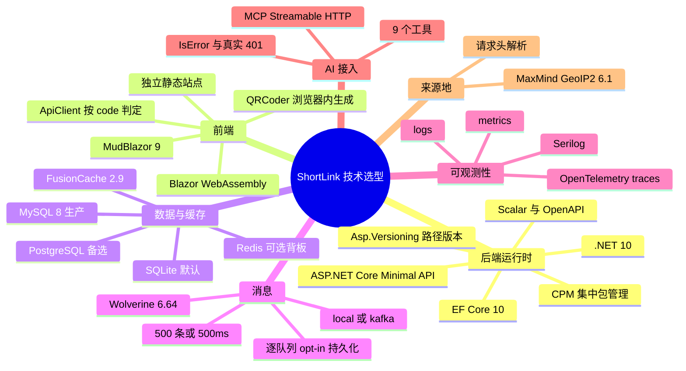
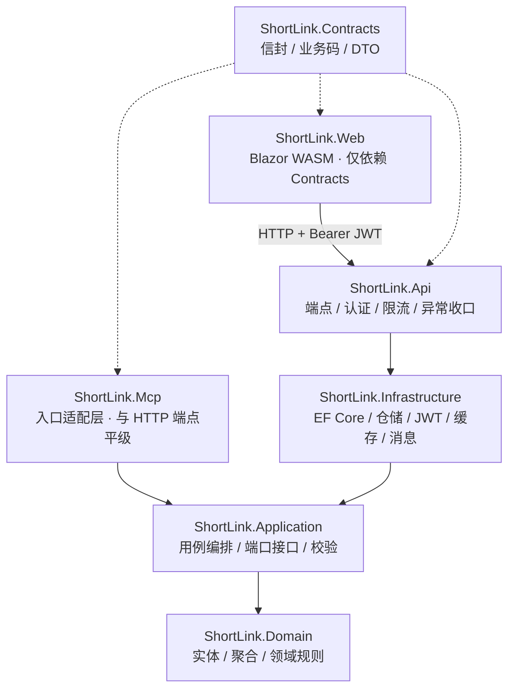
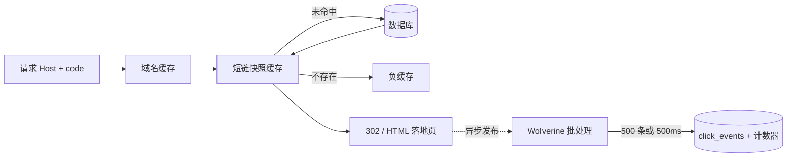
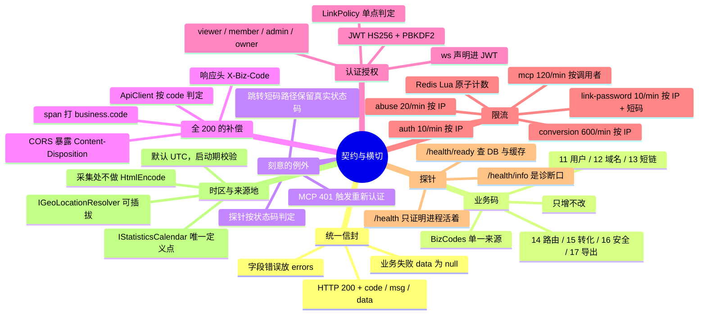
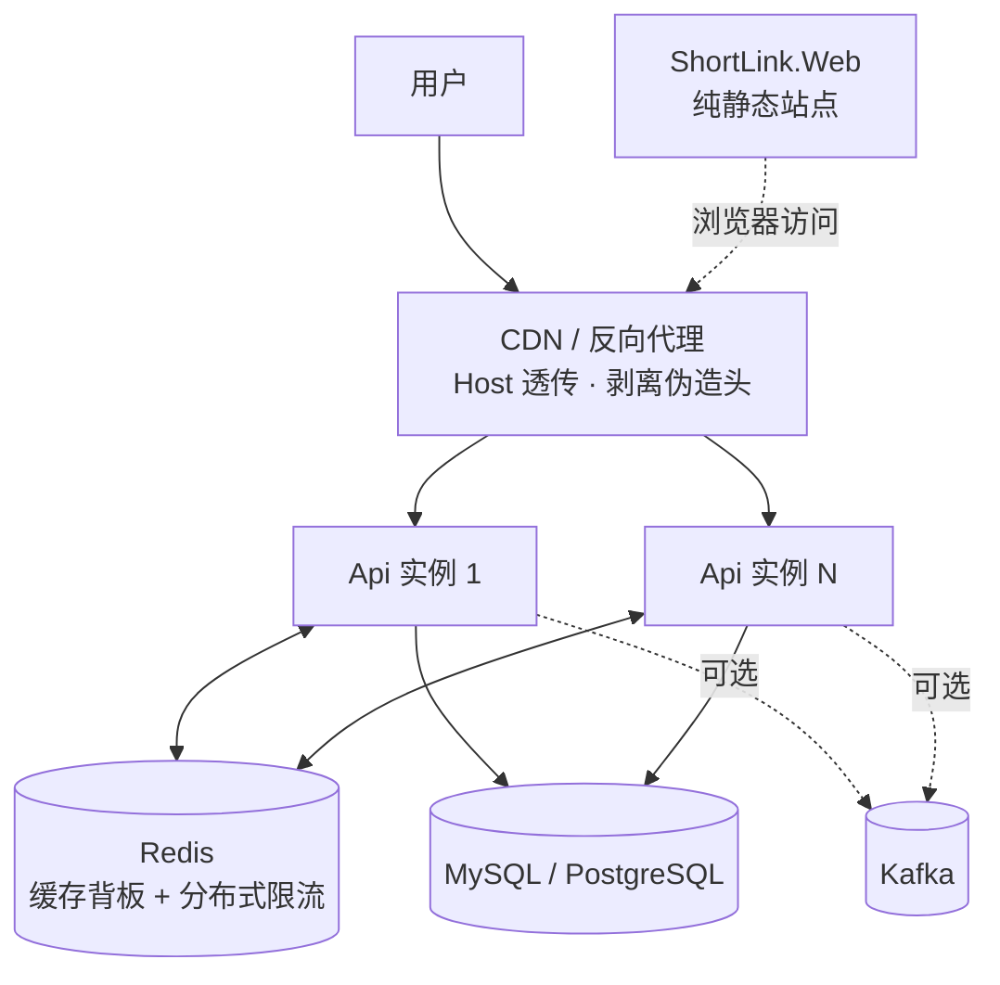
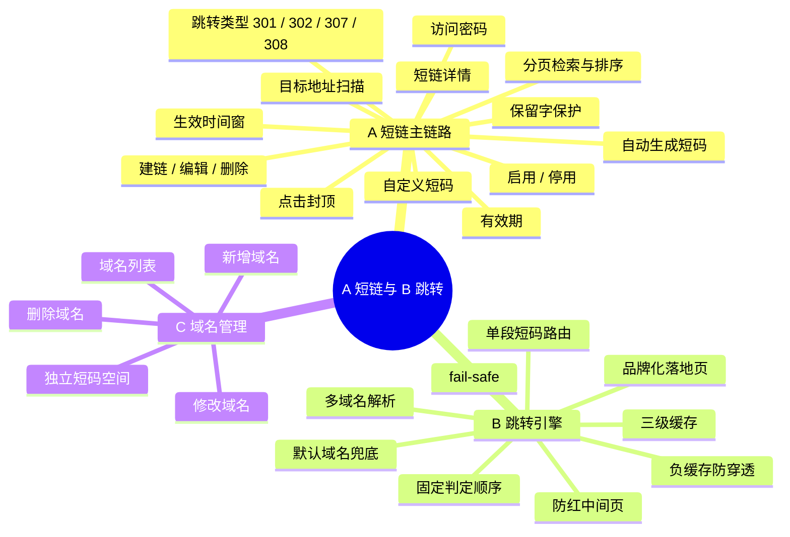
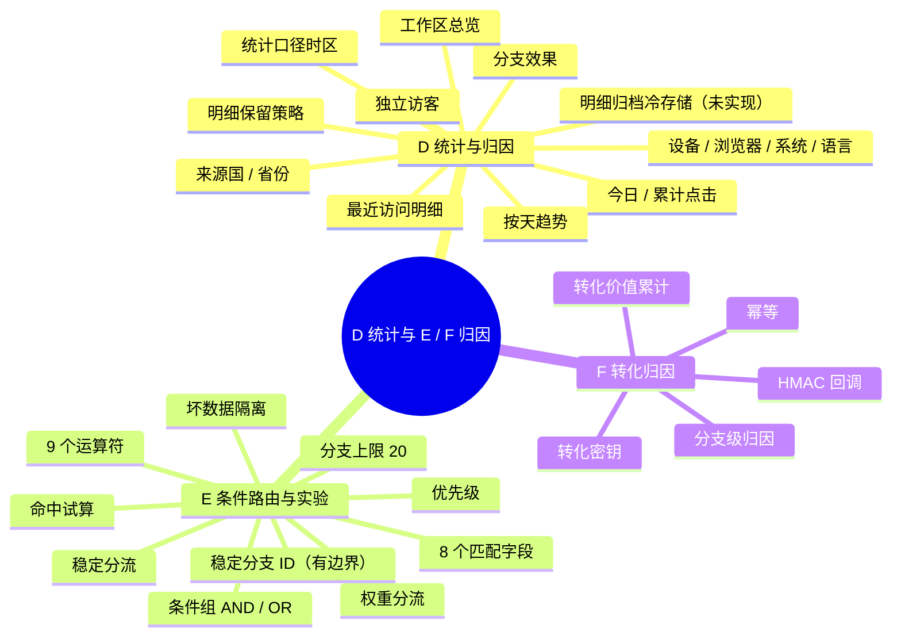
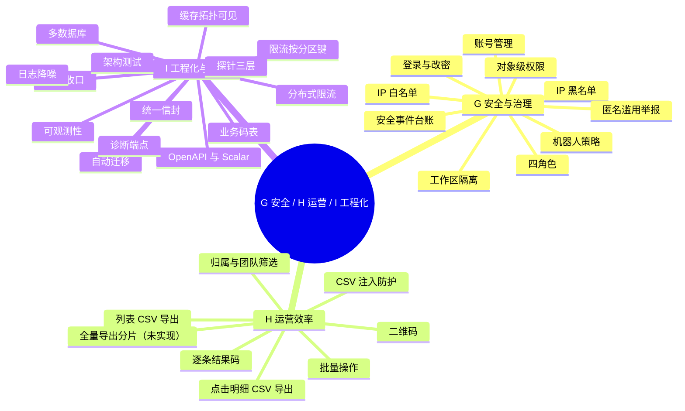
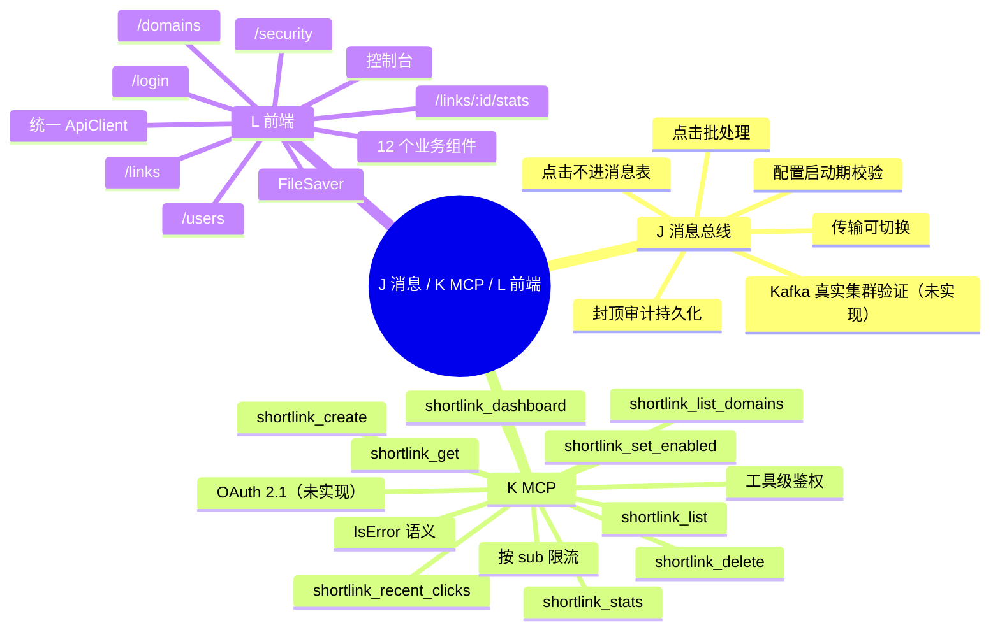

# ShortLink · 架构与功能导图

用 Mermaid 描述架构与功能全景。功能条目与实现位置见 [feature-list.md](feature-list.md)，技术债见 [roadmap.md](roadmap.md)。

状态约定：未标注为已实现；`（有边界）` 表示已实现但有已知限制；`（未实现）` 表示规划中。

---

## 1. 技术选型

## 2. 分层依赖

依赖严格单向，由 ArchUnitNET 在测试阶段守护。

强制约束：

| 层 | 禁止引用 |
| --- | --- |
| `Domain` | EF Core、ASP.NET Core |
| `Application` | EF Core、`Microsoft.AspNetCore.Http` |
| `Infrastructure` | `ShortLink.Api` |
| `Api` | `ProblemDetails`（默认契约是统一信封） |
| `Mcp` | `DbContext`、仓储、`Infrastructure` |

## 3. 核心链路

### 3.1 跳转判定顺序

- 封顶先于启停：达阈值会自动停用，先判状态只会让访客看到「已停用」而不知道原因。
- 密码先于路由：避免未通过校验的人通过命中分支探知目标地址。

### 3.2 缓存与点击管线

- 一次跳转 = 一次缓存读取 + 一次消息发布，不查数据库。
- 短链快照包含规则、密码哈希与时间窗，路由选择是纯内存计算。
- 点击允许丢数据：发布失败只计指标，不阻塞跳转；点击永不进消息表。

### 3.3 统计、路由与归因

| 能力 | 设计要点 |
| --- | --- |
| 统计日界 | `click_date` 由 `IStatisticsCalendar` 计算，写入与读取共用同一日历 |
| 独立访客 | `SHA256(IP + UA + 统计日)` 截断，不可反推；日期与 `click_date` 同源 |
| 维度 TopN | 国家 / 省份、设备、浏览器、系统、语言 |
| 条件路由 | 8 个字段、9 个运算符、AND / OR 条件组、优先级与兜底 |
| A/B 分流 | 种子 `SHA256(visitorKey + linkId + priority)`，同一访客稳定命中 |
| 坏数据隔离 | 条件 JSON 解析失败按「该分支不命中」处理，不把短链打成 404 |
| 转化归因 | HMAC-SHA256 + 5 分钟时间窗，`(link_id, event_id)` 唯一索引幂等 |
| 保留策略 | 按 `clicked_at_utc` 水位分批删除，租约保证多副本互斥，默认关闭 |

## 4. 数据模型

10 张业务表 + 1 张 EF 迁移历史表。完整字段与索引见 [database-design.md](database-design.md)。

| 表 | 角色 | 关键约束 |
| --- | --- | --- |
| `short_links` | 短链聚合根 | `ux(domain_id, code)`；乐观并发令牌 |
| `short_domains` | 域名字典 | `ux(host)`；`ux(default_slot)` 保证至多一个默认域名 |
| `link_routes` | 条件分支 / A/B | `(link_id, priority)`；`ux(link_id, name)` |
| `click_events` | 点击明细，唯一线性增长表 | `ux(event_id)`；8 条索引覆盖统计、明细与清理 |
| `conversion_events` | 转化回调 | `ux(link_id, event_id)` 幂等 |
| `security_events` | 安全审计 | 工作区 / 短链 + 时间索引 |
| `users` | 账号与角色 | `ux(user_name)`；`token_version` 撤销旧令牌 |
| `workspaces` / `workspace_members` | 多租户与成员 | `ux(slug)`；`ux(workspace_id, user_id)` |
| `click_retention_leases` | 清理租约 | 主键 `name`，多副本互斥 |

设计要点：计数器与明细分离；明细按 `click_date` 聚簇；`event_id` 保证点击幂等；清理走 `(clicked_at_utc, id)` 索引。

## 5. 契约与横切

## 6. 部署形态

| 形态 | 组成 |
| --- | --- |
| 单机 | SQLite + 本地队列 + 无 Redis |
| 多实例 | MySQL / PostgreSQL + Redis（缓存 + 限流） |
| 反代 / CDN | Host 透传、`ReverseProxy:KnownProxies`、剥离伪造头 |
| 事件流 | `Messaging:Transport=kafka`（broker 未联调） |
| 前端 | 纯静态托管，与 Api 独立扩缩容 |

## 7. 质量与决策

| 项 | 内容 |
| --- | --- |
| 测试分层 | 单测（领域 / 路由 / 指纹 / 时区 / 地理 / CSV）、集成（WebApplicationFactory + 真实 SQLite 迁移）、架构（ArchUnitNET） |
| 当前默认路径 | 212 通过 + 11 跳过（容器化用例需 `SHORTLINK_TEST_CONTAINERS=1`） |
| 异步校验 | `WaitUntilAsync` 轮询，不用固定 `Task.Delay` |
| ADR 0004 | 多数据库 provider 与迁移程序集分离 |
| ADR 0005 | 条件路由、A/B 分流与转化归因 |
| ADR 0006 | 限流分区、就绪探针与点击明细保留策略 |
| ADR 0007 | MCP Server 接入 |
| ADR 0008 | Wolverine 消息总线与点击不持久化 |
| ADR 0009 | 统计时区、缓存拓扑与来源地解析 |
| ADR 0010 / 0011 / 0012 | Aspire 本地编排 / compose 与 Helm 发布 / 容器化集成测试 |

已知边界：

- 迁移需要按 provider 分别生成，schema 变更要维护三套。
- 点击队列无容量上限，持续过载表现为内存增长。
- Kafka 路径未跑真实 broker，上线前必须联调。
- 来源地默认信任请求头，公网部署需在 CDN 层剥离客户端同名头。
- 离线库更新需重启，且没有过期告警。

---

## 8. 功能全景

### 8.1 短链主链路与跳转

### 8.2 统计、路由与转化

### 8.3 安全、运营与工程化

### 8.4 消息、MCP 与前端

功能条目统计与实现位置见 [feature-list.md](feature-list.md)。
